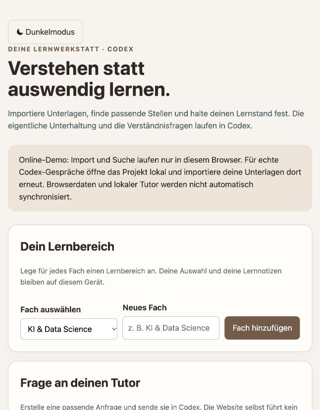
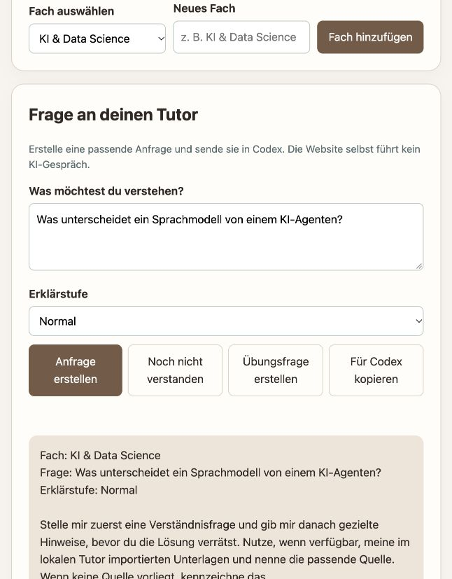
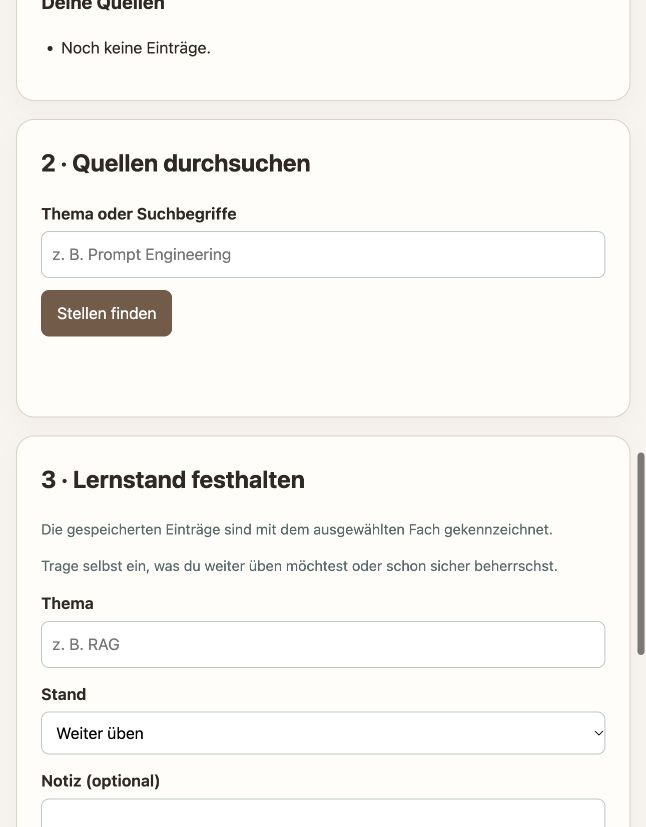

# Sokratischer Lern- und Klausurtutor

[🇩🇪 Deutsch](#-deutsch) | [🇬🇧 English](#-english)

## 🇩🇪 Deutsch

Ein Lerncockpit für Vorlesungen und Prüfungen: Wähle ein Fach, bereite eine Frage vor, durchsuche Unterlagen und lerne mit sokratischen Rückfragen in Codex. Die öffentliche Seite ist eine Browser-Demo; ein tatsächliches Tutorengespräch findet in Codex statt.

### Funktionen

- Lernbereiche für verschiedene Fächer anlegen und beim Speichern von Lernständen kennzeichnen.
- Fragen mit den Erklärstufen einfach, normal und fachlich vorbereiten; Hinweise und Übungsfragen für Codex anfordern.
- Text-, Markdown- und JSON-Unterlagen importieren und mit Fundstellen durchsuchen.
- Lernstand und Notizen festhalten; helles oder dunkles Design wählen.

### So benutzt du den Tutor

1. Öffne die [Tutor-Seite](https://daniilobrant.github.io/sokratischer-tutor-agent/) und wähle ein Fach oder ergänze ein neues.

   

2. Gib unter **Frage an deinen Tutor** deine Frage ein und wähle eine Erklärstufe. Klicke auf **Anfrage erstellen** und dann auf **Für Codex kopieren**. Füge die Anfrage in Codex ein. Mit **Noch nicht verstanden** oder **Übungsfrage erstellen** bereitest du eine Anschlussfrage vor.

   

3. Wähle bei **Unterlagen importieren** eine `.txt`-, `.md`- oder `.json`-Datei und klicke auf **Datei importieren**. Unter **Quellen durchsuchen** findest du Textstellen; unter **Lernstand festhalten** speicherst du dein Thema, deinen Stand und optional eine Notiz.

   

### Schnellstart

1. Python 3 installieren und diesen Projektordner in Codex öffnen.
2. Im Terminal `python3 tutor_tools.py serve` ausführen und die angezeigte lokale Adresse öffnen.
3. Ein Fach anlegen, bei Bedarf Unterlagen importieren und eine Frage mit Erklärstufe vorbereiten.
4. Die Anfrage kopieren und in Codex einfügen. Für Rückfragen und Übungen die entsprechenden Schaltflächen nutzen.

Die Online-Demo speichert Quellen und Lernstand im Browser; der lokale Server nutzt eine separate SQLite-Datenbank. Die beiden Speicher synchronisieren sich nicht. Die Fachauswahl und das Design werden im jeweiligen Browser gespeichert. Alle Quellen werden gemeinsam durchsucht; die Fachauswahl filtert keine Dokumente automatisch. Lernstände werden durch das vorangestellte Fach gekennzeichnet.

### Architektur und Datenschutz

Die Suche ist regelbasiert und erfolgt lokal. Codex übernimmt die KI-Unterhaltung und unterliegt den jeweiligen Nutzungs- und Datenschutzeinstellungen; dabei können an Codex übermittelte Inhalte an dessen Dienst übertragen werden. Es werden keine API-Schlüssel in die Seite eingebettet. Ein Modellumschalter oder eine direkte Chat-Verbindung zu Codex in der Website ist nicht implementiert.

### Dateien und Herkunft

`index.html` enthält das Lerncockpit, `tutor_tools.py` den lokalen Server und die Suche, `role.yaml`, `AGENTS.md`, `workflow.json` und `output.schema.json` beschreiben Rolle und Ablauf. Das Projekt entstand im Rahmen der Vorlesung „Data Science & KI“ bei Prof. Dr. Mathias Engel. Die Organisation des Lernablaufs wurde von [Leonie Trobl Gomez’ Tutor](https://github.com/LeonieTroblGomez/sokratischer-tutor-agent) inspiriert; die Umsetzung basiert auf dem bestehenden Tutor dieses Projekts. Für dieses Projekt ist keine separate Lizenz angegeben.

## 🇬🇧 English

A study dashboard for courses and exams: choose a subject, prepare a question, search your materials, and learn through Socratic questions in Codex. The public page is a browser demo; an actual tutoring conversation takes place in Codex.

### Features

- Create subject areas and label saved learning progress by subject.
- Prepare questions at simple, standard or advanced explanation levels and request hints or exercises for Codex.
- Import and search text, Markdown and JSON learning materials with line references.
- Record progress and notes; choose light or dark appearance.

### How to use the tutor

1. Open the [tutor page](https://daniilobrant.github.io/sokratischer-tutor-agent/) and select or create a subject.

   

2. Enter your question under **Frage an deinen Tutor** and select an explanation level. Click **Anfrage erstellen** to prepare the prompt, then **Für Codex kopieren** to copy it into Codex. Use **Noch nicht verstanden** for a hint or **Übungsfrage erstellen** for a practice question.

   

3. Under **Unterlagen importieren**, select a `.txt`, `.md` or `.json` file and click **Datei importieren**. Search for passages under **Quellen durchsuchen** and save your topic, status and optional note under **Lernstand festhalten**.

   

The website interface is currently in German; these instructions explain its controls in English.

### Getting started

1. Install Python 3 and open this project folder in Codex.
2. Run `python3 tutor_tools.py serve` in a terminal and open the displayed local address.
3. Create a subject, optionally import materials, and prepare a question and explanation level.
4. Copy the prompt into Codex. Use the follow-up buttons to request hints or practice.

The online demo keeps sources and progress in the browser; the local server uses a separate SQLite database. These stores do not sync. Subject selection and theme are saved in each browser. Search covers all imported sources; selecting a subject does not filter documents. Progress entries are labelled with the selected subject.

### Architecture and privacy

Search uses deterministic local rules. Codex handles the AI conversation and is subject to its own terms and privacy settings; content sent to Codex may be transmitted to its service. No API keys are embedded in the page. A model switcher and a direct website-to-Codex chat connection are not implemented.

### Files and attribution

`index.html` contains the dashboard, `tutor_tools.py` the local server and search, and `role.yaml`, `AGENTS.md`, `workflow.json` and `output.schema.json` describe the role and workflow. Created for the “Data Science & AI” course taught by Prof. Dr. Mathias Engel. The learning workflow was inspired by [Leonie Trobl Gomez’s tutor](https://github.com/LeonieTroblGomez/sokratischer-tutor-agent); the implementation builds on this project's existing tutor. No separate project license is specified.
